# Лабораторная работа № 3

**Тема:** Шаблоны. Административная панель Django<br>
**Студент:** Зорькин Арсений Станиславович<br>
**Группа:** ПИЖ-б-о-25-2(1)<br>
**Дата:** 28.09.2026<br>
**Состояние:** выполнена; исходный проект, 12 скриншотов и проверка работы в браузере

## Цель

Вывести товары из базы на HTML-страницу и настроить управление ими через админку.

## Проект

Проект сохранён в `C:\Users\HOME\Desktop\Web-develop\lab3`.

```text
lab3/
├── README.md
├── requirements.txt
├── screenshots/
└── MySite/
    ├── manage.py
    ├── MySite/           # настройки и маршруты
    ├── news/             # страницы из ЛР1
    └── catalog/
        ├── models.py
        ├── views.py
        ├── admin.py
        ├── urls.py
        ├── migrations/
        ├── fixtures/products.json
        └── templates/catalog/index.html
```

Использована модель `Product` варианта 2 из ЛР2. Пример методички с новостями адаптирован к каталогу товаров.

## Запуск

В PyCharm добавлена конфигурация «Сервер Django»: она запускает `manage.py runserver` из папки `MySite`.

При первом запуске из этой папки:

```powershell
python -m venv .venv
.\.venv\Scripts\python.exe -m pip install -r requirements.txt
cd MySite
..\.venv\Scripts\python.exe manage.py migrate
..\.venv\Scripts\python.exe manage.py loaddata products
..\.venv\Scripts\python.exe manage.py createsuperuser
..\.venv\Scripts\python.exe manage.py runserver
```

`loaddata products` загружает четыре учебных товара в новую базу. Данные пользователей и пароли в набор не входят. В подготовленной локальной копии база и администратор уже существуют; доступ записан в `admin-credentials.local.txt`, который исключён из GitHub.

Адреса: [каталог](http://127.0.0.1:8000/catalog/), [админка](http://127.0.0.1:8000/admin/). Корневой адрес `/` тоже открывает каталог; страницы ЛР1 `/news/` и `/news/test/` сохранены.

## Выполнение

### 1 Представление и HTML-шаблон

В [catalog/views.py](MySite/catalog/views.py) получены товары и переданы в шаблон через словарь контекста:

```python
def index(request):
    products = Product.objects.all()
    context = {'products': products, 'title': 'Каталог товаров'}
    return render(request, 'catalog/index.html', context)
```

В [шаблоне](MySite/catalog/templates/catalog/index.html) цикл `for` выводит товары, `if` проверяет наличие, а фильтры форматируют цену и дату:

```django

    <h2>{{ product.name }}</h2>
    <p>{{ product.price|floatformat:2 }} руб.</p>
    
        <p>В наличии · Количество: {{ product.quantity }}</p>
    
        <p>Нет в наличии</p>
    
    <p>{{ product.created_at|date:"d.m.Y H:i" }}</p>

    <p>В каталоге пока нет товаров.</p>

```

После открытия `/catalog/` показаны три товара из ЛР2 (рисунок 1).

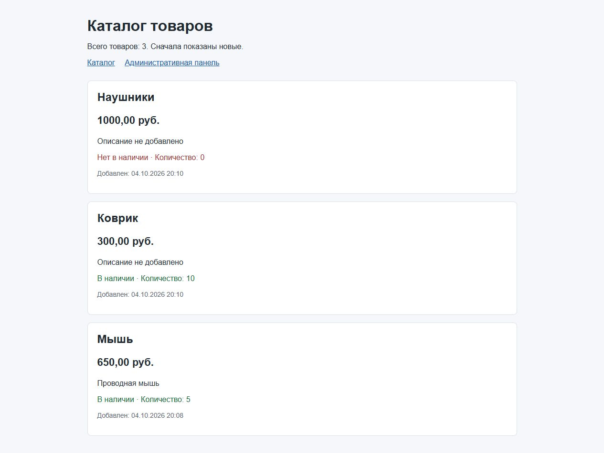

*Рисунок 1 - Вывод товаров из базы в HTML-шаблоне*

### 2 Локализация, названия и сортировка

В настройках заданы `LANGUAGE_CODE = 'ru'` и `TIME_ZONE = 'Europe/Moscow'`. Поля модели получили русские названия. В `CatalogConfig` установлено `verbose_name = 'Каталог товаров'`.

В [модели Product](MySite/catalog/models.py) добавлены параметры:

```python
class Meta:
    verbose_name = 'Товар'
    verbose_name_plural = 'Товары'
    ordering = ['-created_at', '-pk']
```

Новые товары выводятся первыми. Изменения зафиксированы миграцией `0003_alter_product_options_alter_product_created_at_and_more` и применены командой `migrate`. Проверка `manage.py check` завершилась без ошибок.

### 3 Вход в административную панель

Создан локальный суперпользователь. Открыта форма входа `/admin/` (рисунок 2), после входа показан раздел «Каталог товаров» с моделью «Товары» (рисунок 3).

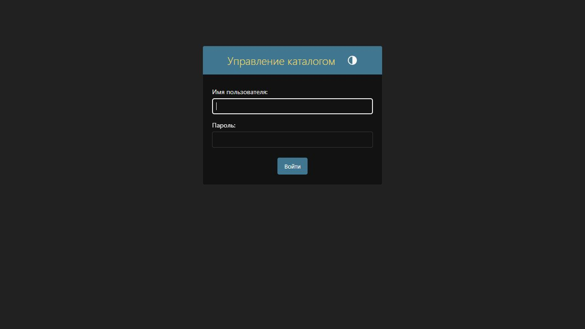

*Рисунок 2 - Форма входа в админку*

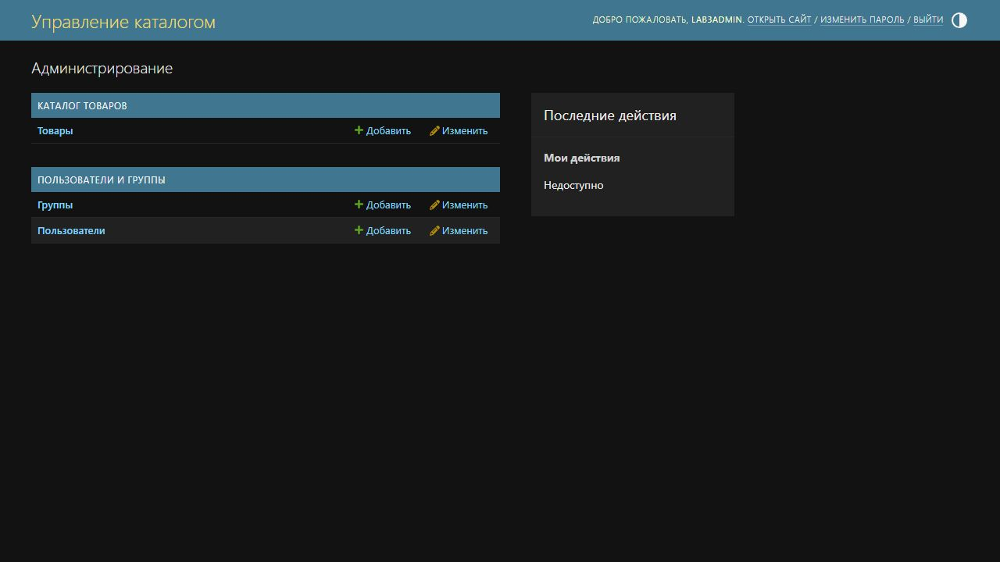

*Рисунок 3 - Главная страница административной панели*

### 4 Настройка списка товаров

В [catalog/admin.py](MySite/catalog/admin.py) модель зарегистрирована вместе с классом `ProductAdmin`:

```python
@admin.register(Product)
class ProductAdmin(admin.ModelAdmin):
    list_display = ('id', 'name', 'price', 'quantity', 'in_stock', 'created_at')
    list_display_links = ('id', 'name')
    list_editable = ('price', 'quantity', 'in_stock')
    search_fields = ('name', 'description')
    list_filter = ('in_stock', 'created_at')
    readonly_fields = ('created_at',)
    date_hierarchy = 'created_at'
    save_on_top = True
```

В таблице видны основные поля. ID и название ведут к форме редактирования; цену, количество и наличие можно менять прямо в списке (рисунок 4).

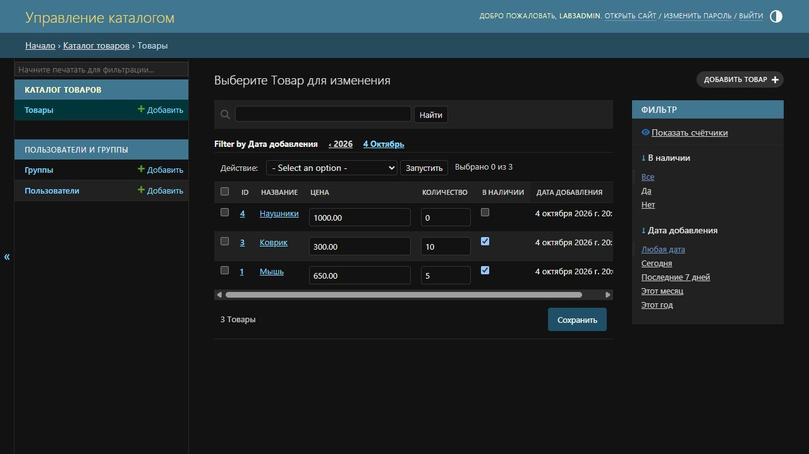

*Рисунок 4 - Настроенный список товаров*

### 5 Поиск и фильтрация

Поиск по слову «Мышь» вернул одну запись (рисунок 5). Фильтр «В наличии: Нет» оставил только наушники (рисунок 6).

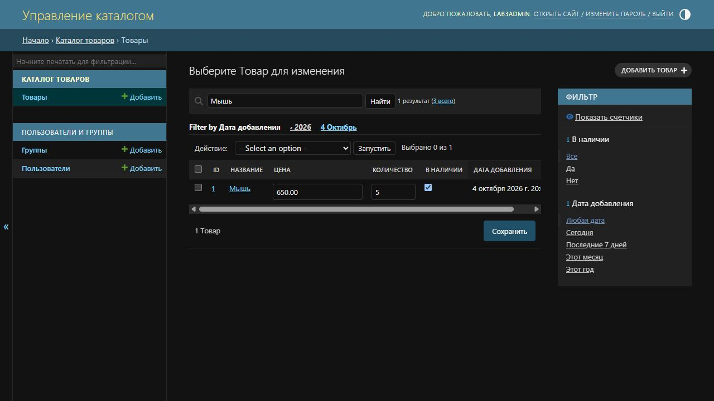

*Рисунок 5 - Поиск товара по названию*

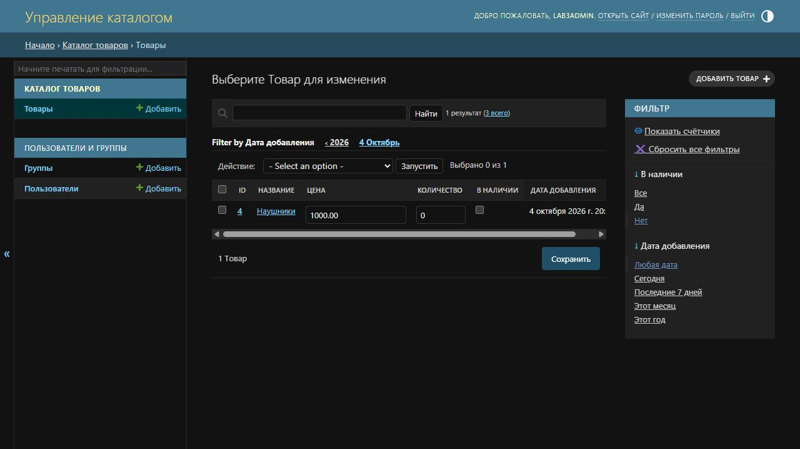

*Рисунок 6 - Фильтр товаров без наличия*

### 6 Добавление товара

Через форму админки добавлен монитор: цена 12 000 рублей, количество 2, наличие включено (рисунок 7). Описание оставлено пустым, что разрешено `blank=True`. Получено сообщение об успешном добавлении; в списке стало четыре товара (рисунок 8).

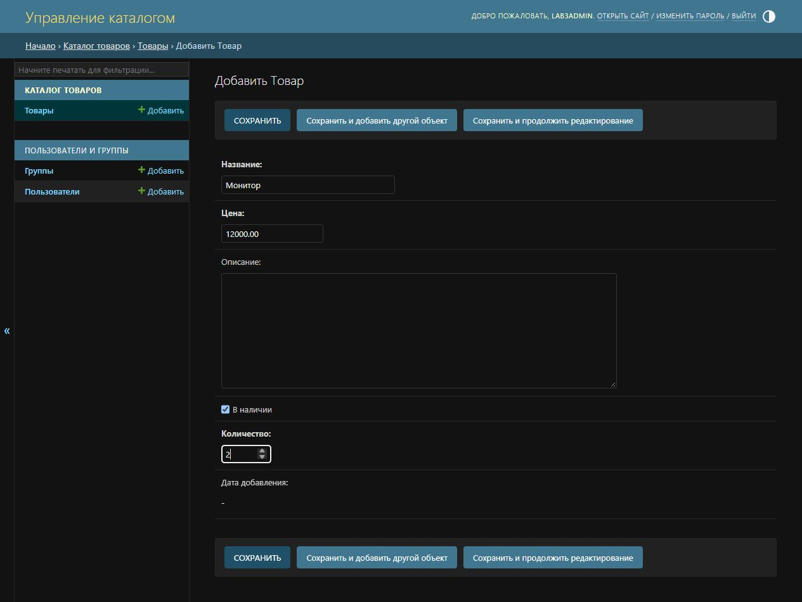

*Рисунок 7 - Заполненная форма добавления монитора*

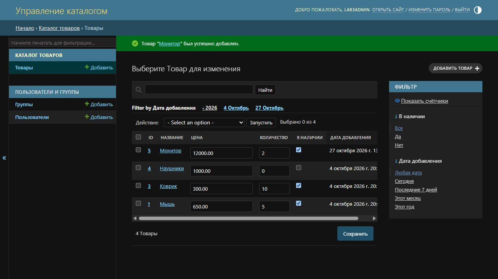

*Рисунок 8 - Успешное сохранение нового товара*

### 7 Редактирование и история

Для монитора установлены цена 11 500 рублей и количество 3, добавлено описание (рисунок 9). После сохранения получено подтверждение изменения (рисунок 10). В истории объекта есть записи о добавлении и изменении полей (рисунок 11).

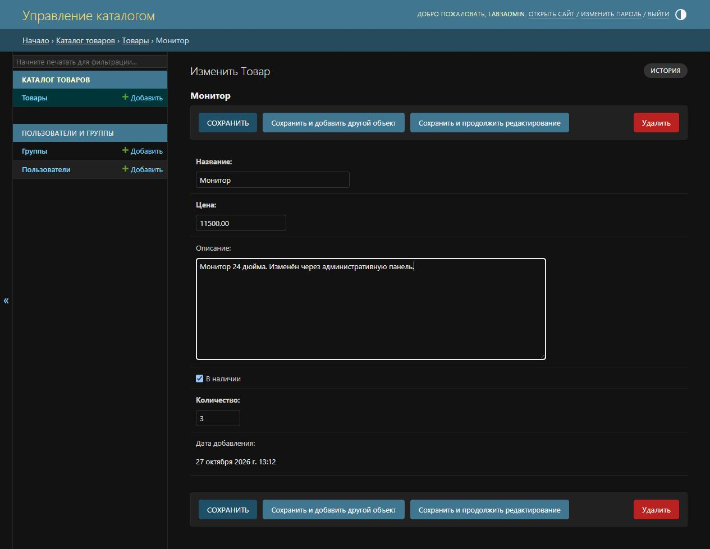

*Рисунок 9 - Изменение цены, описания и количества*

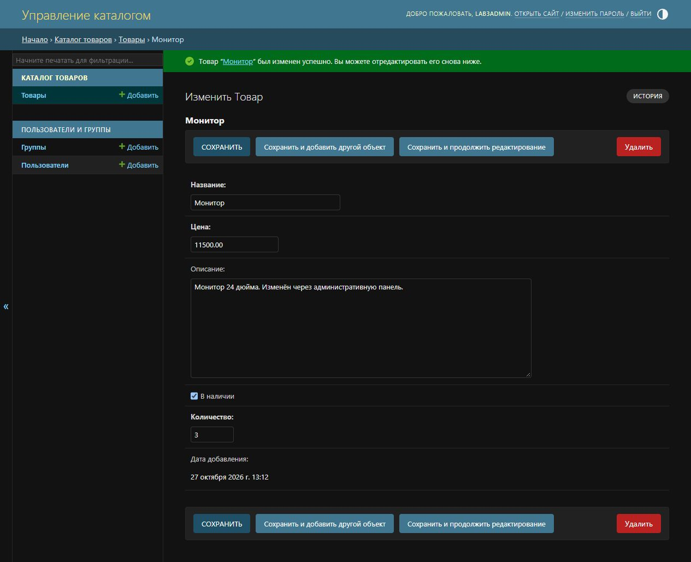

*Рисунок 10 - Подтверждение изменения товара*

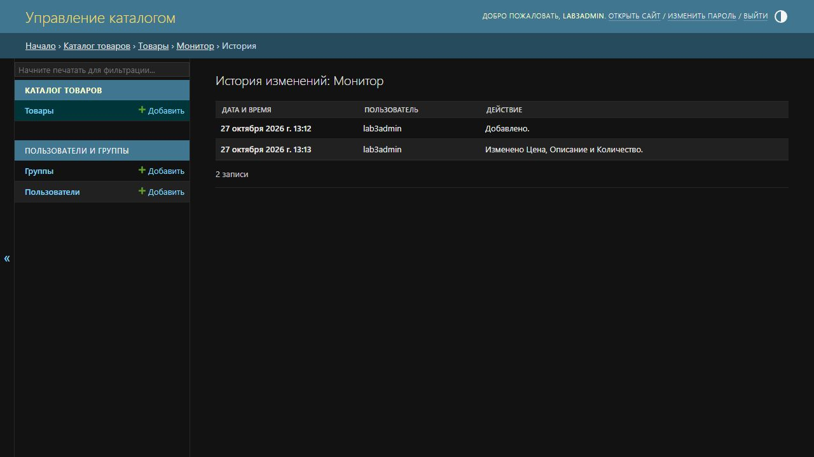

*Рисунок 11 - История действий с товаром*

### 8 Проверка страницы после изменений

Каталог открыт повторно. Новый монитор расположен первым; показаны сохранённые цена 11 500 рублей, количество 3 и описание (рисунок 12).

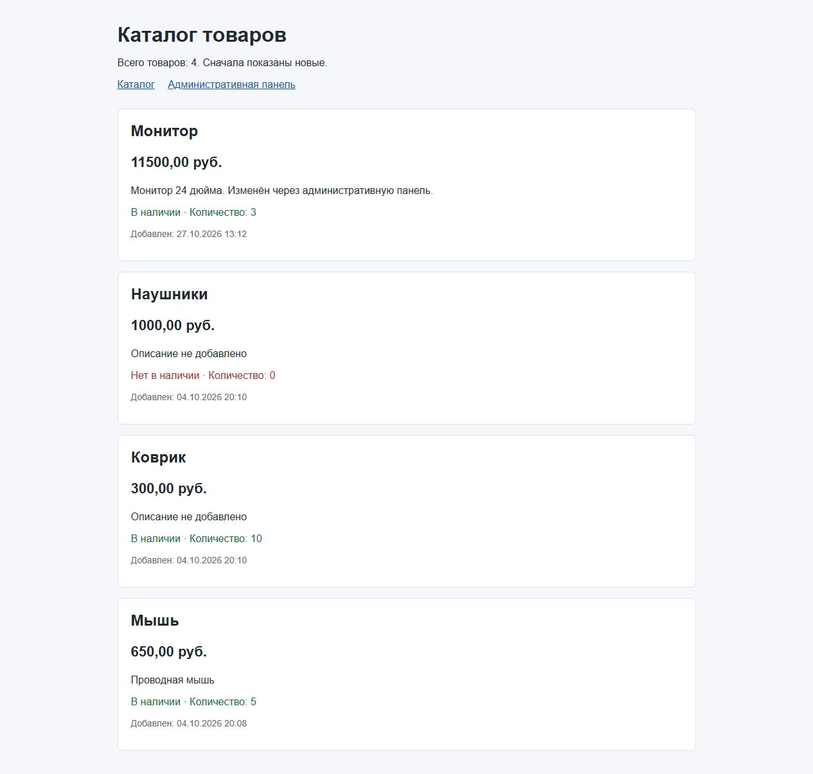

*Рисунок 12 - Каталог после добавления и редактирования товара*

| Товар | Цена, руб. | Количество | Наличие |
| --- | --- | --- | --- |
| Монитор | 11 500,00 | 3 | Да |
| Наушники | 1 000,00 | 0 | Нет |
| Коврик | 300,00 | 10 | Да |
| Мышь | 650,00 | 5 | Да |

## Вывод

Товары из базы выведены через HTML-шаблон. Настроены русские названия, сортировка, поиск, фильтры и редактирование в админке. Через браузер добавлен и изменён товар; результат проверен на странице каталога.
